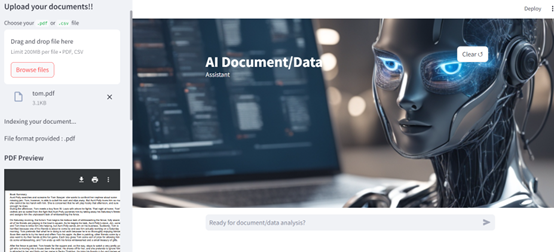
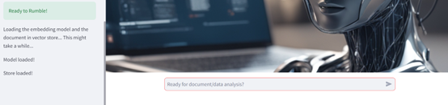
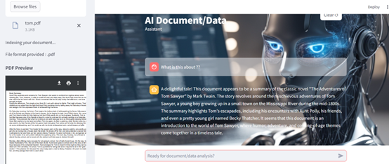

## The idea

An assistant for documents and data: upload a **PDF or CSV**, preview it, let the app load an embedding model and index the document into a vector store, and ask questions in plain language.

**The code is available on request.**

## Screens

  

  

  

 

Part of the work of <a href="https://github.com/johnnyk1090">Giannis Konteas</a> · end-to-end data science

